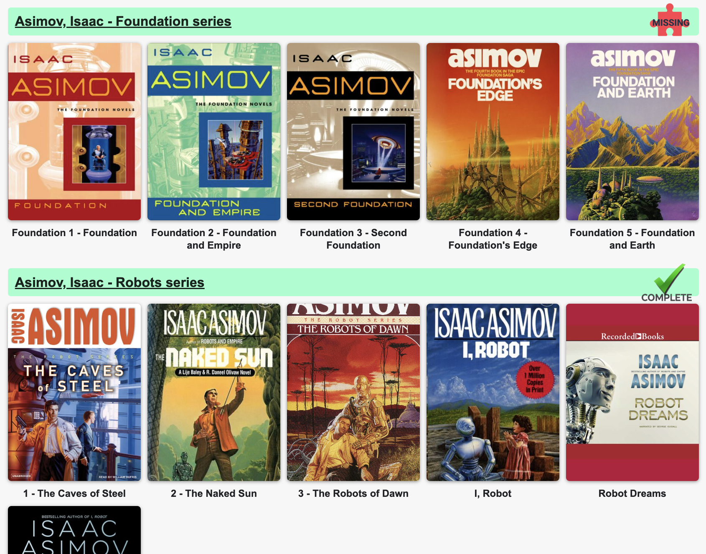

# Audiobook scanner

This python program scans directories of audiobook files and creates an SQL
database and either a webpage for browsing or a compact text list of the books.

The source folders should be organized like this...
<pre>
Audiobooks/
  book_list.txt
  catalog.html
  Fiction/
    Author/ - series
      Book one/
        description.txt
        Track 1.mp3
        Track 2.mp3
      Book two/
        desription.txt
        Track 1.mp3
      series.txt
  Nonfiction/
    Author - series/
      Book one/
        description.txt
        Track 1.mp3
      series.txt
  zz_catalog_files/
    series_complete_small.png
    missing_small.png
    ongoing_small.png
    solo_small.png
    broken_small.png
    podcast_small.png
    library_icon.png
</pre>
Inside the Author - series folder, you should have a series.txt file.  The first
word in this file should be one of COMPLETE, MISSING, ONGOING, SOLO, BROKEN, or
PODCAST.  After that, it can be any combination of text/html.  Formatted text is
ok as whitespace is preserved when rendering the webpage.

Inside the Book folder, there should be a cover.png or cover.jpg file of at least
200x200 resolution.  There can be another file description.txt that contains a
detailed description of the book.  The file may be formatted with HTML tags, or
be raw text.  Note however, that unlike the series.txt file, whitespace is NOT
preserved, so HTML paragraph markers are highly recommended, and any other HTML
formatting can improve the appearance.  If this file is not present, the CONTENT
field in the audio file is used instead.  That should be formatted the same way.

Inside the book folder should also be the audio files themselves.  They can be
in mp3 or m4a format, and can be any length or title.  It is recommended that
they be sortable alphabetically to put them in the proper order for playing.

Where I have the upper level folder Fiction, you can also have other types such
as Nonfiction, Children, Librivox, etc.  These folders are not important, but
allow some coarse organization of the directory.

One more folder at the level of Fiction above should be a zz_catalog_files.
This folder contains the badge images used in the webpage, as well as the page
thumbnail, and come from the GitHub repository.

zz_catalog_files


## Overview

This is a read-only catalogue builder for the audiobook collection.
It scans tags once, records a local SQLite master catalogue, and can export the
same data to XML, TEXT, and HTML. It does **not** write tags or rename files.

## Setup

Run with Python 3.10 or newer. The project is local, so its virtual environment
can live alongside the source code:

```sh
python3 -m venv .venv
. .venv/bin/activate
python -m pip install mutagen
```

## Full set of sample commands:

```sh
python scanner.py scan /Volumes/OtterCloud/Audiobooks/Fiction
python scanner.py scan /Volumes/OtterCloud/Audiobooks/Nonfiction

python scanner.py export-xml tests/audiobook-catalog.xml

python scanner.py export-books-xml tests/audiobook-books.xml

python scanner.py export-book-list tests/book_list.txt
python scanner.py export-html /Volumes/OtterCloud/Audiobooks/catalog.html
```

Finished — tracks: 11764 found, 11764 scanned, 0 unchanged, 0 errors; books: 1037.
Finished — tracks: 409 found, 409 scanned, 0 unchanged, 0 errors; books: 52.
Exported 12173 tracks to tests/audiobook-catalog.xml
Exported 1089 books to tests/audiobook-books.xml
Exported 1089 books to tests/book_list.txt
Exported 1089 books to /Volumes/OtterCloud/Audiobooks/catalog.html

## Later re-scans do not reopen already scanned files

The next identical scan only performs directory/file `stat` checks; audio files
whose size and modified time have not changed are not reopened. `--force` is
available for a complete re-read. Progress is printed every 25 tracks by
default; use `--progress-every 100` for fewer messages or `--progress-every 0`
to disable it. A complete scan also removes tracks no longer found under that
source root, then removes their now-empty book records. This resolves stale
entries after files or folders are renamed or moved. A `--limit` trial scan
never removes database entries.

## Data model

`data/catalog.sqlite3` holds one source root, book paths inferred from folders,
and tracks. Each book has an optional `cover_image_path`: a path relative to the
audiobook root for a direct image file in its folder. The scanner only lists
image files; it never extracts embedded ID3 artwork. It prefers filenames with
`cover`, then `folder` or `front`, falling back to the first image by name.
`author_folder` and `series_folder` preserve the existing first two levels of
this library's directory structure. Each track keeps both normalised catalogue
fields and the raw Mutagen tag map (as JSON), preventing rare ID3 frames from
being discarded. XML is a derived, portable snapshot.

Place an optional UTF-8 `description.html` or `description.txt` directly in a
book folder to replace the ID3-derived description for every track in that
folder. This supports long or corrected descriptions; an empty file
intentionally clears the ID3 comment. If both files exist, `description.html`
takes precedence. The scanner detects changes to the selected file during
incremental scans.

Place an optional UTF-8 `series.html` or `series.txt` directly in a top-level
`Author - Series` folder to record information for the series as a whole. Its
source-relative filename and contents are stored once in the `series_info`
database table.
The first word of the selected file is case-insensitive and may be `COMPLETE`,
`SOLO`, `ONGOING`, `MISSING`, or `BROKEN`; it is stored as the mutually
exclusive series status. `COMPLETE` also sets the existing `is_complete` flag
to `1`. When both files exist, `series.html` takes precedence. The HTML export
displays the corresponding badge in the series header and makes that header a
link which opens the stored series information, without reading the network
drive again.
The recognized status word and whitespace immediately following it are removed
from the stored/displayed series text.

## Other functions supported

`export-xml` creates one entry per audio track. 
`export-books-xml` creates one entry per book folder: it totals duration, byte
size, and track count, and uses the first recorded track's metadata and raw
tags as the book-level set. Its `representative_track_path` identifies that
source track.

`export-book-list` creates the compact `book_list.txt` format: each top-level
Author - Series folder heading is followed by its book folder names indented by
five spaces. Both headings and book names are sorted alphabetically.

`export-html` creates an interactive catalogue grouped by Author - Series
folder. It uses up to five cover thumbnails per row; clicking a cover toggles
that book's details. Series headers with a `series.html` or `series.txt` file
open its stored content; their explicit status determines one of the `complete`,
`solo`, `ongoing`, `missing`, or `broken` badges in `zz_catalog_files/`. Cover images use URLs relative to the generated HTML file,
so place the catalogue at the audiobook-library level (for example,
`/Volumes/OtterCloud/Audiobooks/catalog.html`) to produce `Fiction/...` image
links that also work through another mount or an HTTP server.

## Other options to modify command behavior
`--source-root` is used by the `export-html` command when creating web links for cover images.  Strip this part off the front of the file path, and you get a relative path from the web page.  Example, the option `--source-root /Volumes/OtterCloud/Audiobooks` turns IMG SRC="file:///Volumes/OtterCloud/Audiobooks/Fiction/Adams/Hitchhiker/Cover.jpg" into IMG SRC="Fiction/Adams/Hitchiker/Cover.jpg".  Note that the path needs to look like the path used by the current operating system (Windows would use something like `--source-root W:\Audiobooks`).

`--database` allows changing which database file to use.  This project is now local, so its default `data/` directory is the intended location for the database. Use `--database /a/local/path/catalog.sqlite3` only when you want a separate catalogue.


Script to create the webpage and book lists...

# Full Catalog on Mac
rm data/catalog.sqlite3
python scanner.py scan /Volumes/OtterCloud/Audiobooks/Fiction
python scanner.py scan /Volumes/OtterCloud/Audiobooks/Nonfiction
python scanner.py scan /Volumes/OtterCloud/Audiobooks/LibriVox
python scanner.py export-html /Volumes/OtterCloud/Audiobooks/catalog.html --source-root /Volumes/OtterCloud/Audiobooks
python scanner.py export-book-list /Volumes/OtterCloud/Audiobooks/book_list.txt

# Full Catalog on Windows
del data\catalog.sqlite3
python scanner.py scan W:\Audiobooks\Fiction
python scanner.py scan W:\Audiobooks\Nonfiction
python scanner.py scan W:\Audiobooks\LibriVox
python scanner.py export-html W:\Audiobooks\catalog_win.html --source-root W:\Audiobooks
python scanner.py export-book-list W:\Audiobooks\book_list_win.txt



# Example outputs
<li>Example list file: <A href="output_examples/book_list.txt">book_list.txt</A>
<li>Example html file: <A href="output_examples/catalog.html">catalog.html</A>
<br>Note that the html example above doesn't have the image files here.

<li>sample image of html file: <A href="output_examples/screenshot.png">screenshot.png</A></li>
